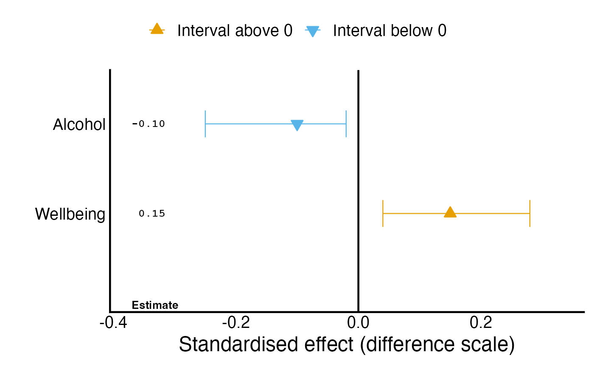

# Average-effect reporting and outcome scales

[`margot_plot_ate()`](https://go-bayes.github.io/margot/reference/margot_plot_ate.md),
[`margot_table_ate()`](https://go-bayes.github.io/margot/reference/margot_table_ate.md)
and
[`margot_interpret_ate()`](https://go-bayes.github.io/margot/reference/margot_interpret_ate.md)
produce a figure, a numerical table and prose from the same reporting
calculation.
[`margot_plot()`](https://go-bayes.github.io/margot/reference/margot_plot.md)
remains available and returns all three as `plot`, `transformed_table`
and `interpretation`. The example below uses invented estimates and
sensitivity quantities; it fits no model and uses no participant data.

``` r
estimates <- data.frame(
  outcome = c("wellbeing_z", "alcohol_z"),
  ATE = c(0.15, -0.10),
  E_Value = c(1.8, 1.6),
  E_Val_bound = c(1.3, 1.2)
)
estimates[["2.5 %"]] <- c(0.04, -0.25)
estimates[["97.5 %"]] <- c(0.28, -0.02)
scales <- data.frame(
  outcome = c("wellbeing_z", "alcohol_z"),
  transformation = "identity",
  center = c(4, 3), scale = c(1.2, 2), orientation = 1,
  unit = c("points", "drinks"), unit_multiplier = 1
)
margot_plot_ate(estimates, scale_info = scales, e_val_bound_threshold = 1)
#> ℹ no multiplicity adjustment applied
#> ℹ Transformed label: wellbeing_z -> Wellbeing
#> ℹ Transformed label: alcohol_z -> Alcohol
#> Loading required package: dplyr
#>
#> Attaching package: 'dplyr'
#> The following objects are masked from 'package:stats':
#>
#>     filter, lag
#> The following objects are masked from 'package:base':
#>
#>     intersect, setdiff, setequal, union
```



``` r
print(margot_table_ate(estimates, scale_info = scales, e_val_bound_threshold = 1), row.names = FALSE)
#> ℹ no multiplicity adjustment applied
#> ℹ Transformed label: wellbeing_z -> Wellbeing
#> ℹ Transformed label: alcohol_z -> Alcohol
#>    Outcome ATE (standardised) 95% CI lower 95% CI upper Original-scale estimate
#>    Alcohol              -0.10        -0.25        -0.02                   -0.20
#>  Wellbeing               0.15         0.04         0.28                    0.18
#>  95% CI lower (original scale) 95% CI upper (original scale)
#>                         -0.500                        -0.040
#>                          0.048                         0.336
#>   Original-scale quantity 95% CI relative to 0 E-value E-value bound
#>  mean difference (drinks)              below 0     1.6           1.2
#>  mean difference (points)              above 0     1.8           1.3
#>  E-value bound > 1
#>                yes
#>                yes
cat(margot_interpret_ate(estimates, scale_info = scales, e_val_bound_threshold = 1))
#> ℹ no multiplicity adjustment applied
#> ℹ Transformed label: wellbeing_z -> Wellbeing
#> ℹ Transformed label: alcohol_z -> Alcohol
#> Intervals are 95% confidence intervals; this call applied no further adjustment for multiple comparisons.
#>
#> Of the 2 average treatment effects, 2 have confidence intervals that exclude 0. They are listed in plot order, from top to bottom.
#>
#> The E-value bound is the smallest risk ratio that an unmeasured confounder would need with both the treatment and the outcome, beyond the measured covariates, to move the interval limit nearest 0 to 0. For these difference-scale estimates it uses the approximation RR = exp(0.91 |d|), where d is the standardised difference. The note in brackets says whether the bound exceeds 1; the threshold does not change which outcomes are listed.
#>
#> - Alcohol: ATE (standardised) = -0.100 (95% CI: -0.250 to -0.020); on the original scale, mean difference = -0.200 drinks (95% CI: -0.500 to -0.040). E-value bound = 1.200 (exceeds 1).
#> - Wellbeing: ATE (standardised) = 0.150 (95% CI: 0.040 to 0.280); on the original scale, mean difference = 0.180 points (95% CI: 0.048 to 0.336). E-value bound = 1.300 (exceeds 1).
```

The graph retains the supplied model-scale estimates and intervals. The
table names each outcome in an “Outcome” column, which its row names
repeat, and retains those numbers in an “ATE (standardised)” column with
its interval limits, and adds the original-scale estimate and limits,
headed by the quantity and unit (for example “Mean difference
(points)”). The interval level appears in the headers, or in a “CI
level” column when coverage varies by outcome. A decision column states
whether each interval lies above, includes or lies below the null, and a
separate column flags whether the E-value bound exceeds the threshold.
Prose lists every outcome whose interval excludes the null and reports
the supported conversion alongside the model-scale estimate. The E-value
threshold sets only that flag; it does not decide which estimates are
reported, establish identification or remove the need to report other
planned outcomes. E-values remain tied to their supplied scientific
scale and calculation, not to a change of display units.

## Record preparation constants

Let `Y` denote the measured outcome and `g` its declared transformation.
Metadata describes the model outcome as
`orientation * (g(Y) - center) / scale`. Each row of `scale_info`
matches an original outcome key before display labels change. Store the
constants from preparation rather than recomputing them from a reporting
subset.

| Field             | Meaning                                                          | Default    |
|-------------------|------------------------------------------------------------------|------------|
| `outcome`         | Original outcome key in the estimate table                       | Required   |
| `transformation`  | `identity`, `log`, or `log1p`                                    | `identity` |
| `center`          | Centre subtracted during preparation                             | 0          |
| `scale`           | Positive divisor used during preparation                         | 1          |
| `orientation`     | Outcome orientation, 1 or -1                                     | 1          |
| `unit`            | Unit label for the reported affine difference                    | Empty      |
| `unit_multiplier` | Positive affine unit conversion, such as 60 for hours to minutes | 1          |

For an affine mean difference, the centre cancels. The estimate and both
supplied confidence limits are multiplied by
`orientation * scale * unit_multiplier`; reversed limits are reordered.
This preserves asymmetric intervals and numerical precision. Display
functions may round printed numbers, but the numerical table retains
their precision. A ratio of centred outcomes cannot generally be
converted to an original-scale ratio from that contrast alone;
unsupported ratio conversions fail explicitly.

## The applied NZAVS convention uses unlogged values before standardisation

For the New Zealand Attitudes and Values Study (NZAVS), the current
applied preparation convention keeps continuous baseline and lagged
adjustment variables on their unlogged scientific scales before
z-standardisation. Exposure columns used to define an intervention
retain the registered exposure scale. Terminal outcomes also remain
unlogged: the exercise outcome is `hours_exercise`, measured in hours
per week. Scoring and orientation remain explicit measurement decisions;
omitting a logarithm does not remove those decisions.

For each terminal outcome, preparation records the unweighted mean and
sample standard deviation among that outcome’s primary estimation rows.
It applies those constants once and retains them across primary fits,
sensitivity analyses, groups, policy folds, and reports. This is the
same standardisation convention used by the developing GRF workflow. The
reference rows and their missing-data rule belong in the preparation
record. An unweighted standardisation reference does not replace the
analysis weights used to estimate a target-population contrast. Baseline
and lagged adjustment variables retain their own preparation constants,
separately from terminal-outcome constants.

The following example uses three invented primary-row exercise values
and an invented estimated contrast, interval, and E-values. It fits no
model. The saved mean is 2 hours per week, and the sample standard
deviation is 2 hours per week.

``` r
primary_hours_exercise <- c(0, 2, 4)
exercise_center <- mean(primary_hours_exercise)
exercise_scale <- sd(primary_hours_exercise)
exercise_z <- (primary_hours_exercise - exercise_center) / exercise_scale

exercise_estimate <- data.frame(
  outcome = "hours_exercise_z",
  ATE = 0.25,
  `2.5 %` = 0.10,
  `97.5 %` = 0.40,
  confidence_level = 0.95,
  E_Value = 1.8,
  E_Val_bound = 1.4,
  check.names = FALSE
)
exercise_scale_info <- data.frame(
  outcome = "hours_exercise_z",
  transformation = "identity",
  center = exercise_center,
  scale = exercise_scale,
  orientation = 1,
  unit = "hours per week",
  unit_multiplier = 1
)
exercise_table <- margot_table_ate(
  exercise_estimate,
  scale_info = exercise_scale_info,
  e_val_bound_threshold = 1
)
#> ℹ no multiplicity adjustment applied
#> ℹ Transformed label: hours_exercise_z -> Hours Exercise
print(exercise_table[, c("Outcome", "ATE (standardised)", "Mean difference (hours per week)",
  "95% CI lower (hours per week)", "95% CI upper (hours per week)")], row.names = FALSE)
#>         Outcome ATE (standardised) Mean difference (hours per week)
#>  Hours Exercise               0.25                              0.5
#>  95% CI lower (hours per week) 95% CI upper (hours per week)
#>                            0.2                           0.8
cat(margot_interpret_ate(
  exercise_estimate,
  scale_info = exercise_scale_info,
  label_mapping = list(hours_exercise_z = "Weekly exercise"),
  e_val_bound_threshold = 1
))
#> ℹ no multiplicity adjustment applied
#> ℹ Mapped label (exact): hours_exercise_z -> Weekly exercise
#> Intervals are 95% confidence intervals.
#>
#> The confidence interval for this estimate excludes 0.
#>
#> The E-value bound is the smallest risk ratio that an unmeasured confounder would need with both the treatment and the outcome, beyond the measured covariates, to move the interval limit nearest 0 to 0. For these difference-scale estimates it uses the approximation RR = exp(0.91 |d|), where d is the standardised difference. The note in brackets says whether the bound exceeds 1; the threshold does not change which outcomes are listed.
#>
#> - Weekly exercise: ATE (standardised) = 0.250 (95% CI: 0.100 to 0.400); on the original scale, mean difference = 0.500 hours per week (95% CI: 0.200 to 0.800). E-value bound = 1.400 (exceeds 1).
```

The contrast of 0.25 standard deviations corresponds to 0.5 hours per
week, with the supplied 95% interval transformed to 0.2–0.8 hours per
week. The mean cancels from the difference. These are two scales for the
same affine mean contrast; the original-unit companion is not a new fit.

## Logarithms remain available for other outcome definitions

The applied NZAVS convention above does not remove Margot’s
general-purpose logarithmic reporting. Historical analyses retain their
specifications, and another scientific question may explicitly define a
logged outcome. The reported quantity must match that definition.

Exponentiating a difference of mean log outcomes gives a ratio of
geometric means. With `log1p`, it gives a ratio of geometric means of
`Y + 1`. Neither quantity is generally an arithmetic mean difference or
an arithmetic mean ratio. A transformed contrast cannot recover a
missing arithmetic-mean causal estimand merely by substituting a
reference mean.

``` r
control <- c(0, 3)
policy <- c(1, 7)
log_difference <- mean(log1p(policy)) - mean(log1p(control))
c(shifted_geometric_mean_ratio = exp(log_difference),
  arithmetic_mean_difference = mean(policy) - mean(control))
#> shifted_geometric_mean_ratio   arithmetic_mean_difference
#>                          2.0                          2.5
```

The shifted geometric ratio is 2, whereas the arithmetic mean difference
is 2.5. These are different scientific quantities. Nonlinear reported
values therefore receive explicit geometric-ratio labels, and legacy
arithmetic `_original` columns remain missing. Do not pass the displayed
geometric ratio to a risk-ratio E-value formula.

## Existing calls

Calls to
[`margot_plot()`](https://go-bayes.github.io/margot/reference/margot_plot.md)
retain the combined list, argument precedence and saving behaviour. From
the development version after 1.3.2, the decision, ordering, table
columns and E-value comparison follow new defaults;
`category_rule = "interval_and_evalue"`,
`e_val_bound_comparison = ">="`, `e_val_bound_conversion = "rounded"`,
`order_direction = "bottom_to_top"` and `table_columns = "legacy"`
reproduce the earlier categories, values, table and prose. For ratio
estimates under `order = "magnitude_desc"` or `"magnitude_asc"`, which
now rank by the absolute log ratio, reproducing the earlier order
exactly also needs `order = "custom"` with that order. The three focused
interfaces select their respective component; `save_output = TRUE` still
saves the complete list. Existing `original_df` calls infer
transformations from outcome suffixes and matching unstandardised source
columns, with a warning that scale constants may be recomputed. Legacy
log names mean `log1p`; explicit `scale_info` distinguishes ordinary
logarithms. Missing or ambiguous source columns require explicit
metadata. No reporting path should substitute an invented population
mean.

When regenerating an existing study report, retain its
estimation-version record and separately record the reporting version
and corrected quantities. Reporting corrections do not imply that an
earlier study was estimated with a later package release.
